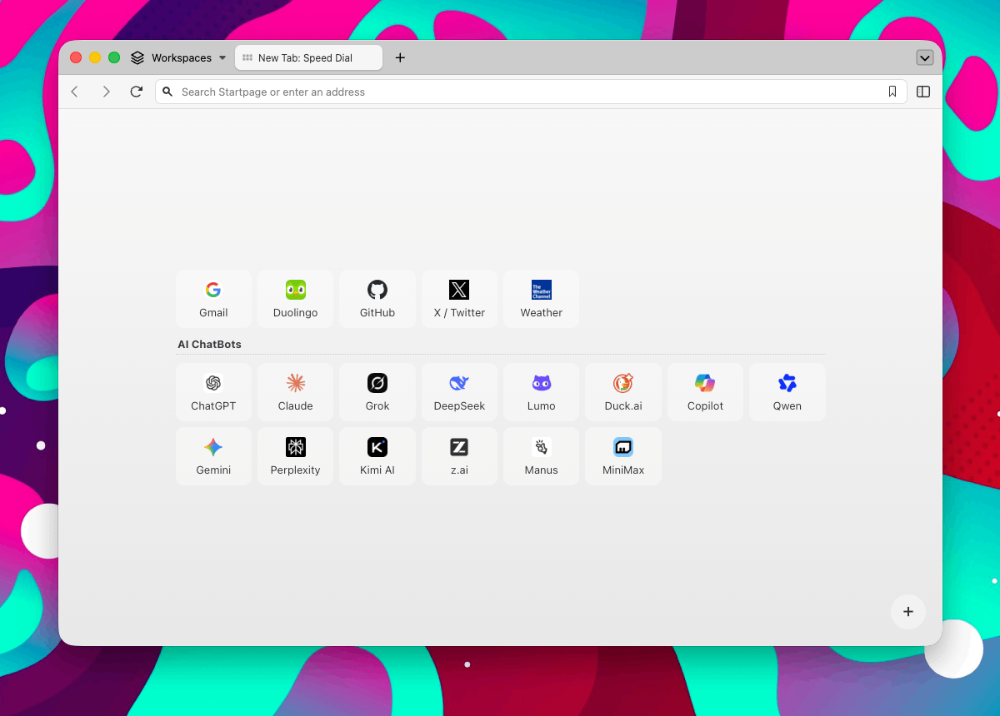

# Minimal Speed Dial

> Browser extension that replaces the new tab page with a minimal speed dial, automatically populated by the links bookmarked on the `Bookmarks/HomePage` folder.

- 🌐 Chrome: [chromewebstore.google.com/detail/minimal-speed-dial/nfbo...](https://chromewebstore.google.com/detail/minimal-speed-dial/nfbokdfpeanknhkligpmpmlhpakkeold)
- 🦊 Firefox: [addons.mozilla.org/addon/minimal-speed-dial](https://addons.mozilla.org/addon/minimal-speed-dial/)

This Browser extension replaces the default new tab page with a minimal speed dial interface. It pulls links and subfolders from the `Bookmarks/HomePage` folder, allowing users to organize and access their bookmarks without Chrome’s 10-link restriction.

- **Top Sites wall**. Bookmarks are shown as page previews on a curved 3D wall with a floor reflection.
- **Page previews**. Captured locally when you visit a bookmarked site, or on demand with the ↻ button on a tile (loads the page in the background with your logged-in session). Optional permission, stored only in your browser.
- **Folders as pages**. Subfolders of `HomePage` become pages; switch with the folder bar, by swiping/dragging, or with the arrow keys.
- **Search**. Filter all bookmarks from the search field; Enter opens the first match.
- **High-res icons**. Fetches large site icons (Google favicon service, then the site's `apple-touch-icon`), falling back to the browser favicon.
- **No link limit** and **automatic sync** with the `HomePage` bookmarks folder.
- **Edit** button for quick access to the Bookmarks Manager.

A lightweight alternative for users who prefer a straightforward, customizable new tab page.

## Installation

1. Download or clone this repository
2. Open Chrome and go to `chrome://extensions/`
3. Enable "Developer mode" in the top right corner
4. Click "Load unpacked" and select the extension `/src` directory

## Getting Started

The extension reads bookmarks from a folder named **`HomePage`** inside your
bookmarks bar. If you don't already have one, you'll see a "No bookmarks found."
message — here's how to fix it:

1. Open your browser's **Bookmarks Manager**
   (`chrome://bookmarks/` or `about:bookmarks`).
2. Create a new folder called **`HomePage`** in the bookmarks bar.
3. Add your favorite links inside that folder. Bookmark subfolders
   are automatically displayed as grouped sections.
4. Open a new tab — your speed dial will appear instantly.

> The **Edit** button in the bottom-left corner is a shortcut
> to the Bookmarks Manager for quick editing.

---

&mdash; [@alterebro](https://x.com/alterebro)
