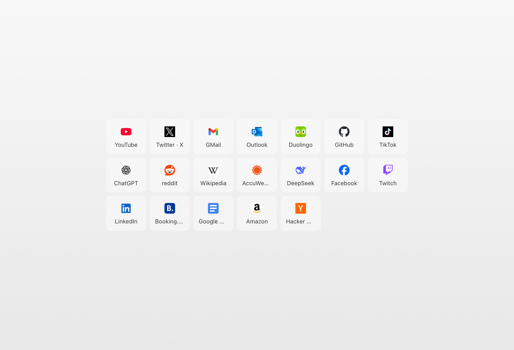

# Minimal Speed Dial

> Chrome extension that replaces the new tab page with a minimal speed dial, automatically populated by the links bookmarked on the `Bookmarks/HomePage` folder and removes Chrome’s default 10-link limit.

This Chrome extension replaces the default new tab page with a minimal speed dial interface. It pulls links from the `Bookmarks/HomePage` folder, allowing users to organize and access their bookmarks without Chrome’s 10-link restriction.

- **No link limit**. Display as many bookmarks as needed.
- **Automatic sync**. Bookmarks saved in the `HomePage` folder appear instantly.
- **Simplified design**. Removes distractions, focusing only on quick access to saved links.

A lightweight alternative for users who prefer a straightforward, customizable new tab page.

## Installation

1. Download or clone this repository
2. Open Chrome and go to `chrome://extensions/`
3. Enable "Developer mode" in the top right corner
4. Click "Load unpacked" and select the extension `/src` directory

---

&mdash; [@alterebro](https://x.com/alterebro)